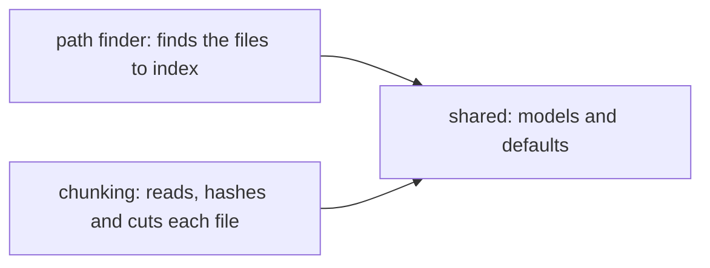

# Block division

- date: 2026-11-09
- coherence: 2026-11-11

## Blocks

### Block 1: shared (src/shared/: models.py, defaults.py)
- receives: nothing (no other block, no external source)
- processes: nothing at runtime; defines the shared data structures and values
- delivers: the pydantic models of spec point 4.9 (data models), the internal models (Chunk with its text and character range, the settings of each index version), the default values and the fixed limits (e.g. max_chunk_size ceiling 2000)
- depends on: no block

### Block 2: path finder
- receives: the raw folder path, from the index command (CLI argument; default data/raw from block 1 shared)
- processes: walks the raw folder and keeps the .py, .md and .txt files (whitelist); does not read them
- delivers: the list of paths of the files to index; raises an exception when the folder is missing or has no such file (spec point 4.1 case 2)
- depends on: block 1 shared

### Block 3: chunking
- receives: from the "index" service, the list of paths found by path finder (list[str]) and the previous index version as {path: (hash, chunks)} (empty dict = full rebuild)
- processes: reads each file once in binary, skips empty and non-UTF-8 ones, compares its sha256 with the previous one, copies the old chunks if equal or cuts it with the chunker of its type (registry by extension, common base class)
- delivers: two dicts {path: (hash, chunks)}: the full one (valid files that exist now) and the one with only new or changed files
- depends on: block 1 shared

## Diagram (Mermaid)

## Decided

- Block 1 holds only shared data: the spec point 4.9 models, the internal models (Chunk, index version settings) and the defaults and fixed limits.
- Defaults in block 1 never replace CLI arguments: every path still comes from a CLI argument (prohibitions 3: no hard-coded input/output paths). Values computed at runtime (N, number of chunks of the active index; T, time of one answer on CPU) are not in block 1.
- Block 1 is named shared: package src/shared/ with models.py (pydantic models) and defaults.py (defaults and fixed limits).
- The interfaces of spec point 7 (retriever, chunker, generator) are not in block 1: each one goes in the block that implements it.

- Block 2 is named path finder (user decision, 2026-11-11; "route" rejected because in FastAPI routes are the API endpoints). The block name does not fix the class names: a block can hold several classes. It only finds files: it walks the raw folder and delivers the paths of the .py, .md and .txt files (whitelist, spec point 4.1 case 3); it does not read them (user decision, 2026-11-11). It receives the raw folder path from the index command as a CLI argument; its default data/raw comes from block 1 shared (prohibitions 3: no hard-coded paths) (user decision, 2026-11-11). If the raw folder is missing or has no .py, .md or .txt file (spec point 4.1 case 2), block 2 only raises an exception with the message; the index command (CLI layer) catches it, prints it on stderr, records it in the run log and returns exit code != 0 (spec point 7 method 4: thin CLI) (user decision, 2026-11-11). Block 2 depends only on block 1 shared (default raw folder and the extension whitelist); it does not depend on the CLI: the CLI calls block 2 and passes the path as a parameter, so there is no cycle and block 2 can be tested alone (user decision, 2026-11-11).
- Block 3 is named chunking (user decision, 2026-11-11: reading, hashing and comparing are parts of chunking). one chunker per type (.py, .md, .txt) chosen from a registry by extension (spec point 7 method 2, constraints 10). A common base class does the shared steps once, for every type (template method): read the file once in binary mode, skip it if empty, decode UTF-8 (warning and skip if it fails), compute the sha256 of the same bytes, and copy its previous chunks if the hash did not change (incremental, spec point 4.1 case 12); only then it calls the type's own chunk(text). Each chunker implements only chunk(text). Reading in binary and decoding keeps \r\n, so positions and hash come from the same bytes (user decision, 2026-11-11). It receives the paths found by path finder as a list[str], passed by an "index" function of the shared service layer (spec point 7 method 4) that chains path finder, chunking and the saving of the index version; the CLI only calls that service, path finder does not call chunking, and the API and the CLI never duplicate this sequence (user decision, 2026-11-11, option o3 over path finder calling chunking or the CLI passing the paths). From the previous index version it receives a dict {path: (hash, chunks)}, prepared by the "index" service through the versioned index store (spec point 7 method 3; the service never reads data/processed directly, and the file format is decided in the index block, pending 65). An empty dict means full rebuild: the service passes it when there is no previous version or it is unreadable (spec point 4.1 case 14, with a warning) or when max_chunk_size or the embedding model changed (case 13). The chunking block computes the hash itself and compares; it knows nothing of folders or formats (user decision, 2026-11-11). It delivers two dicts with the same shape {path: (hash, chunks)}, each chunk being the Chunk model of block 1 shared: the full one (only files that exist now and are valid; deleted, empty and non-UTF-8 files are left out) and the one with only new or changed files. The embeddings step gets both (computes vectors only for the second, copies the rest); BM25 gets only the full one, because its statistics depend on all chunks and are always recomputed (spec point 4.1 case 12). The full dict is the next run's previous version, and the count of the second goes to the run log (goals 6) (user decision, 2026-11-11). The chunking block depends only on block 1 shared (the Chunk model and the 2000 ceiling); it does not depend on the "index" service, which calls it: depending means importing another block's code, not being called by it (user decision, 2026-11-11).

## Pending

- Next session (user decision, 2026-11-11): first define every piece the "index" service uses, then the service itself. Done: i1 path finder, i2 chunking. To define, one by one: i3 BM25 statistics (gets the full dict from chunking, always recomputed over all chunks); i4 embeddings (gets both dicts, embeds only new or changed files, copies the rest; without the model the index is built without the semantic part, spec point 4.1 case 15); i5 versioned index store (loads the previous version for chunking; writes, verifies and activates the new one, spec point 4.1 cases 7 to 11, pending 65); i6 the "index" service itself (chains i5 load → i1 → i2 → i3 → i4 → i5 save). The user has not yet confirmed that these are the 4 they meant nor which one goes first.
- Service layer (the "index" orchestrator and the other service functions: search, search_dataset, answer, answer_dataset, evaluate with recall@k): which block holds it.
- Blocks after these: not proposed yet (the user proposes them block by block, row 403 of workflow).
