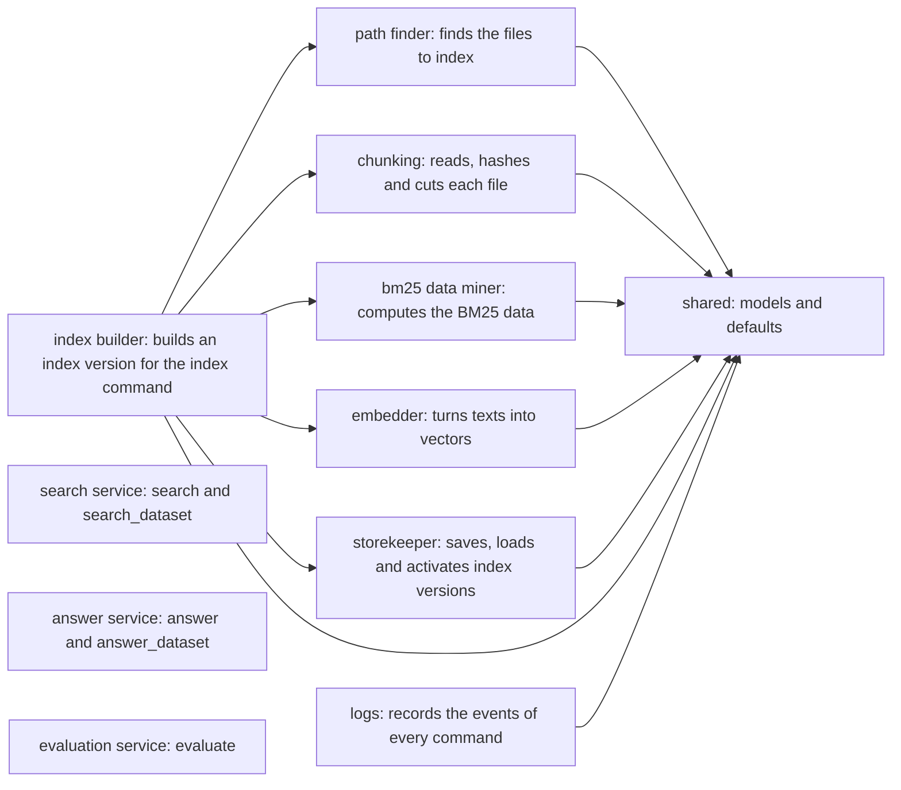

# Block division

- date: 2026-11-09
- coherence: 2026-11-14

## Blocks

### Block 1: shared (src/shared/: models.py, defaults.py)
- receives: nothing (no other block, no external source)
- processes: nothing at runtime; defines the shared data structures and values
- delivers: the pydantic models of spec point 4.9 (data models), the internal models (Chunk with its text and character range, the settings of each index version), the default values and the fixed limits (e.g. max_chunk_size ceiling 2000)
- depends on: no block

### Block 2: path finder
- receives: the raw folder path, from the index builder, which gets it already resolved from the index command (CLI argument; default data/raw from block 1 shared)
- processes: walks the raw folder and keeps the .py, .md and .txt files (whitelist); does not read them
- delivers: the list of paths of the files to index; raises an exception when the folder is missing or has no such file (spec point 4.1 case 2)
- depends on: block 1 shared

### Block 3: chunking
- receives: from the index builder, the list of paths found by path finder (list[str]) and the previous index version as {path: (hash, chunks)} (empty dict = full rebuild)
- processes: reads each file once in binary, skips empty and non-UTF-8 ones, compares its sha256 with the previous one, copies the old chunks if equal or cuts it with the chunker of its type (registry by extension, common base class)
- delivers: two dicts {path: (hash, chunks)}: the full one (valid files that exist now) and the one with only new or changed files
- depends on: block 1 shared

### Block 4: bm25 data miner
- receives: from the index builder, the full dict {path: (hash, chunks)} delivered by chunking
- processes: computes, over all chunks, the term frequency of each word in each chunk (tf), the number of chunks that contain each word (df), the length of each chunk in tokens, the average chunk length (avgdl) and the number of chunks (N)
- delivers: the BM25 data (tf, df, lengths, avgdl, N) to the index builder, which passes them to the storekeeper to save them in the new version; it does not score: scoring with a query and the top-k are done at search time by another block (Bm25Retriever, spec point 7 method 1)
- depends on: block 1 shared

### Block 5: embedder
- receives: at index time, from the index builder, only the dict of new or changed files of chunking; at search time, a query
- processes: turns texts into vectors with the embedding model: the chunks of new or changed files at index time, the query at search time (same model)
- delivers: at index time, the vectors of the new or changed chunks, to the index builder (which merges them with the old ones); at search time, the query vector, to the SemanticRetriever (spec point 7 method 1)
- depends on: block 1 shared; external source: the embedding model all-MiniLM-L6-v2 (through its library)

### Block 6: storekeeper
- receives: in every call, the processed folder of the store to act on (from the index builder, or from the service that loads the index, pending 93); to save a new version, from the index builder: the chunks of every file with its path and hash, the BM25 data, the vectors of the chunks (optional: missing when the embedding model was not available, spec point 4.1 case 15) and the settings of the version (max_chunk_size and embedding model name)
- processes: at start, removes leftovers of dead runs (spec point 4.1 case 9); loads the active version (for the index builder and for search: CLI and API); if a version with the same corpus and settings exists, only makes it active (nothing if it already is); otherwise writes the new version apart, verifies it inside the store and only then makes it active (if verification fails, removes it and the previous one stays active, case 7); when the corpus changes, removes the versions of the old generation (unless pending 90, two generations, is adopted)
- delivers: on load, the content of the active version (the chunks of every file with its path and hash, the BM25 data computed by bm25 data miner, the vectors if present, and the settings) or "no index" (spec point 4.2 case 1, search without index; spec point 4.1 case 14, previous version unreadable); on save or activate, to the index builder: the name of the version left active (new version saved and verified, or existing version with the same corpus and settings only activated, "index already up to date" if it already was) or an error when verification fails (the new version is removed and the previous one stays active, spec point 4.1 case 7)
- depends on: block 1 shared (the models of chunks, settings and BM25 data, pending 86: block 4 BM25 data structure)

### Block 7: index builder
- receives: from the index command of the CLI, values already resolved: the raw folder path, max_chunk_size and the processed folder path
- processes: chains the pieces: storekeeper load → path finder → chunking → bm25 data miner → embedder → storekeeper save
- delivers: to the CLI, the data of the final message (active version, number of chunks, processed folder, files reprocessed and copied) or an error with its message
- depends on: block 1 shared, block 2 path finder, block 3 chunking, block 4 bm25 data miner, block 5 embedder, block 6 storekeeper

### Block 8: logs
- receives: the log folder (--log_dir, default logs/ from block 1 shared), from the CLI once per run (the API server once, at start); the events to record (warnings, errors, the final message of index), shaped by the event model of block 1 shared, through direct calls to its methods from the code of the CLI commands and of the API server
- processes: validates each event with the event model; on the first event of a run, creates the log folder and the file of that run (one file per run, its name generated by the block); appends each event as a new line at the end, never rewriting the file
- delivers: to whoever calls it, on each event the confirmation that it was recorded or the failure (pending 95); at the end of a run, on request, the path of the file of that run, or "no file" if nothing was recorded
- depends on: block 1 shared (the event model and the default log folder)

### Block 9: search service (name not decided yet)
- receives: values already resolved by the CLI or the API: the query (search; CLI argument or /search request), the dataset path (search_dataset, --dataset_path), k, the method (lexical, semantic or hybrid), the output folder (search_dataset, --save_directory) and the processed folder (passed to the storekeeper, pending 93)
- processes: the service functions of search and search_dataset (CLI; search also from the API, /search); the rest not decided yet
- delivers: not decided yet
- depends on: not decided yet

### Block 10: answer service (name not decided yet)
- receives: not decided yet
- processes: the service functions of answer and answer_dataset (CLI; answer also from the API, /answer); the rest not decided yet
- delivers: not decided yet
- depends on: not decided yet

### Block 11: evaluation service (name not decided yet)
- receives: not decided yet
- processes: the service functions of evaluate (CLI only); the rest not decided yet
- delivers: not decided yet
- depends on: not decided yet

## Diagram (Mermaid)

## Decided

- Block 1 holds only shared data: the spec point 4.9 models, the internal models (Chunk, index version settings) and the defaults and fixed limits.
- Defaults in block 1 never replace CLI arguments: every path still comes from a CLI argument (prohibitions 3: no hard-coded input/output paths). Values computed at runtime (N, number of chunks of the active index; T, time of one answer on CPU) are not in block 1.
- Block 1 is named shared: package src/shared/ with models.py (pydantic models) and defaults.py (defaults and fixed limits).
- The interfaces of spec point 7 (retriever, chunker, generator) are not in block 1: each one goes in the block that implements it.

- Block 2 is named path finder (user decision, 2026-11-11; "route" rejected because in FastAPI routes are the API endpoints). The block name does not fix the class names: a block can hold several classes. It only finds files: it walks the raw folder and delivers the paths of the .py, .md and .txt files (whitelist, spec point 4.1 case 3); it does not read them (user decision, 2026-11-11). It receives the raw folder path from the index command as a CLI argument; its default data/raw comes from block 1 shared (prohibitions 3: no hard-coded paths) (user decision, 2026-11-11). If the raw folder is missing or has no .py, .md or .txt file (spec point 4.1 case 2), block 2 only raises an exception with the message; the index command (CLI layer) catches it, prints it on stderr, records it in the run log and returns exit code != 0 (spec point 7 method 4: thin CLI) (user decision, 2026-11-11). Block 2 depends only on block 1 shared (default raw folder and the extension whitelist); it does not depend on the CLI: the CLI calls block 2 and passes the path as a parameter, so there is no cycle and block 2 can be tested alone (user decision, 2026-11-11).
- Block 3 is named chunking (user decision, 2026-11-11: reading, hashing and comparing are parts of chunking). one chunker per type (.py, .md, .txt) chosen from a registry by extension (spec point 7 method 2, constraints 10). A common base class does the shared steps once, for every type (template method): read the file once in binary mode, skip it if empty, decode UTF-8 (warning and skip if it fails), compute the sha256 of the same bytes, and copy its previous chunks if the hash did not change (incremental, spec point 4.1 case 12); only then it calls the type's own chunk(text). Each chunker implements only chunk(text). Reading in binary and decoding keeps \r\n, so positions and hash come from the same bytes (user decision, 2026-11-11). It receives the paths found by path finder as a list[str], passed by an "index" function of the shared service layer (spec point 7 method 4) that chains path finder, chunking and the saving of the index version (superseded 2026-11-16: that function is block 7, index builder, which chains storekeeper load, path finder, chunking, bm25 data miner, embedder and storekeeper save); the CLI only calls that service, path finder does not call chunking, and the API and the CLI never duplicate this sequence (user decision, 2026-11-11, option o3 over path finder calling chunking or the CLI passing the paths). From the previous index version it receives a dict {path: (hash, chunks)}, prepared by the index builder through the storekeeper (spec point 7 method 3; the service never reads data/processed directly, and the file format is decided in the index block, pending 65). An empty dict means full rebuild: the service passes it when there is no previous version or it is unreadable (spec point 4.1 case 14, with a warning) or when max_chunk_size or the embedding model changed (case 13). The chunking block computes the hash itself and compares; it knows nothing of folders or formats (user decision, 2026-11-11). It delivers two dicts with the same shape {path: (hash, chunks)}, each chunk being the Chunk model of block 1 shared: the full one (only files that exist now and are valid; deleted, empty and non-UTF-8 files are left out) and the one with only new or changed files. The embeddings block gets only the second and returns its vectors; the index builder merges them with the old vectors of the unchanged files (user decision, 2026-11-14); BM25 gets only the full one, because its data depend on all chunks and are always recomputed (spec point 4.1 case 12). The full dict is the next run's previous version, and the count of the second goes to the run log (goals 6) (user decision, 2026-11-11). The chunking block depends only on block 1 shared (the Chunk model and the 2000 ceiling); it does not depend on the index builder, which calls it: depending means importing another block's code, not being called by it (user decision, 2026-11-11).

- The cache (spec point 4.8, caching) is not a piece of the index builder: it stores query results of search and answer, and index makes no queries. Index never deletes cache entries, because it would have to import the cache block code (index -> cache, a cycle with cache -> index); the cache cleans its own entries of old index versions (when and how: pending 84, cache cleanup timing and check on write) (user decision, 2026-11-11).

- Block 4 (bm25 data miner, i3 of the index builder pieces) processes, always over all chunks of the full dict from chunking (spec point 4.1 case 12: lexical data always recomputed): tf of each word in each chunk, df of each word, length of each chunk in tokens (not characters), avgdl and N. In BM25 each document is one chunk, not one file, so N is the number of chunks and df counts chunks (user decision, 2026-11-14). It delivers only the BM25 data, to the index builder (i6), which passes them to the storekeeper (i5) to save them in the new version. It never scores: at index time there is no query (the index command takes no query, spec point 4.1), and one index version serves many queries; scoring with the query and the top-k belong to the search-time block (Bm25Retriever, spec point 7 method 1) (user decision, 2026-11-14). A query word that is not in the index adds 0 to every chunk. The structure kept and when idf is computed: pending 86 (block 4 BM25 data structure). Block 4 is named bm25 data miner (user decision, 2026-11-16; renamed from bm25 stats, chosen 2026-11-14, so that the word "statistics" is kept only for search results; "indexer" rejected because it clashes with the index builder i6, "lexical index" not chosen, "bm25 counter" proposed by the agent and not chosen). It depends only on block 1 shared (the Chunk model): it imports no code of chunking or path finder; the index builder calls chunking first and passes the full dict to bm25 data miner in memory as a parameter, so the order is the service's job and bm25 data miner reads no file (user decision, 2026-11-14).

- Block 5 (embeddings, i4 of the index builder pieces) has one task: turn texts into vectors. At index time it gets only the dict of new or changed files of chunking and returns only their vectors (on a first run or a full rebuild, spec point 4.1 cases 13 and 14, that dict holds every file; when nothing changed it is empty and nothing is embedded). It does not get the old vectors: chunking already decided with the hash which files changed, so there is nothing to compare. The merge is done by the index builder (i6): the storekeeper (i5) loads the previous version with its vectors, and for each file of the full dict i6 takes the new vectors if it changed or the old ones if not; deleted files are not in the full dict, so their vectors never reach the new version; i6 passes the result to i5 to save it (user proposal, approved 2026-11-14, over i4 receiving both dicts and the old vectors). It also embeds queries at search time, with the same embedding model as the chunks, for the SemanticRetriever (spec point 7 method 1): cosine similarity only compares vectors of the same model, and doing it in two places could silently use different models or settings. That it is a function of a class is decided in the development of the block (user decision, 2026-11-14). Without the embedding model, the index is built without the semantic part (spec point 4.1 case 15). Running embeddings and answer generation in parallel threads: pending 87 (embeddings and answer threads). Block 5 is named embedder: its only task is turning texts into vectors, for chunks and for queries (user decision, 2026-11-14). It depends only on block 1 shared (the Chunk model); the embedding model is an external source, used through its library (fastembed or sentence-transformers, pending 17: library comparison), not a block; when its weights are downloaded: pending 88 (embedding model download) (user decision, 2026-11-14).

- Block 6 (storekeeper, i5 of the index builder pieces) receives from the index builder, to save a new version: the chunks of every file with its path and hash, the BM25 data, the vectors (optional: a version without the semantic part is valid, spec point 4.1 case 15, so --method hybrid falls back to lexical with a warning) and the settings of the version, max_chunk_size and embedding model name (spec point 4.1 case 11). The settings are needed so the next index run knows when to rebuild everything (case 13) and so queries are embedded with the same model as the chunks. It depends only on block 1 shared; for this, the model of the BM25 data goes in shared (pending 86) (user decision, 2026-11-14). Versions per settings (user proposal, approved 2026-11-14): a version is identified by the corpus generation plus its settings (e.g. v1_1000, v1_2000); index with existing settings only switches the active version, with nothing changed it builds nothing ("index already up to date"), with new settings it builds v1_<new> and keeps the others, and when the corpus changes it builds the new generation incrementally and deletes the old one; one single active version, the last indexed (search and the API take no max_chunk_size). Spec point 4.1 is edited once, at the end of the block division (user decision, 2026-11-16), together with pending 89 (spec change for versions per settings), 93 (processed folder argument), 94 (final index message in the run log) and 96 (method value bm25 renamed lexical). Keeping two generations is a test candidate: pending 90 (disk of two generations). Reusing a version built with one max_chunk_size for another one (e.g. v1_1000 for 800 or for 1500) is rejected (user decision, 2026-11-14): measured on the corpus, 1723 of 1969 files are longer than 800 characters, and 4644 of 10993 top-level .py units are longer than 1000, 1368 of them between 1000 and 1500, so the chunks differ and reusing them would fake the chunk size measurement of pending 29; a version is reused only when its settings match exactly. What block 6 processes (user decision, 2026-11-14): removes leftovers at start; loads the active version (loading means reading it from disk into memory for whoever asks: the index builder, to compare hashes and copy what did not change, and search, to score; each command is a separate process, so search starts with nothing in memory); switches to an existing version with the same corpus and settings, or writes, verifies and activates a new one; removes the old generation when the corpus changes. Verification is part of the store, inside the index command, never a separate script, because the evaluator only runs the commands; the pointer file and subfolders are in pending 65 (index store implementation).
- What block 6 delivers on load (user decision, 2026-11-16, e2 approved after the user objection that everything can be found from the pointer file): the content of the active version (chunks with path and hash, the BM25 data computed by bm25 data miner, the vectors if present, the settings) or "no index" (spec point 4.2 case 1; spec point 4.1 case 14). Only block 6 reads the pointer file and the version subfolders. Reason (coupling): the pointer only names the active version; if the index builder (i6), the CLI search and the API server read the disk themselves, all three must know the disk format (pending 65: index store implementation) and repeat its error cases, e.g. a missing vectors file (spec point 7 method 3).
- What block 6 delivers on save or activate (user decision, 2026-11-16, agent proposal e1 approved): to the index builder (i6), the name of the version left active, in three cases: e1.1 new version saved and verified (e.g. v2_1000), used for the final message of spec point 4.1 case 10 (index finished); e1.2 a version with the same corpus and settings already exists: nothing is built, it is only activated and its name delivered, and if it was already active the message is "index already up to date: <version>" (pending 89: versions per settings); e1.3 verification fails: the new version is removed, an error is delivered and the previous version stays active (spec point 4.1 case 7). The index builder never reads the disk to know what happened.
- Block 6 is named storekeeper (user decision, 2026-11-16; "versioned index store" was only provisional): like the keeper of a warehouse, it receives, stores, delivers and removes index versions; "warehouse shipping" (user idea) not chosen because it names only the delivery, "version keeper" not chosen.
- Which versions exist (user decision, 2026-11-16): the storekeeper knows them by listing its own processed folder (every version is a subfolder named v<generation>_<max_chunk_size>); there is no separate registry for now. Each processed folder (index argument, default data/processed) is a separate store, so an index run with another processed folder rebuilds a version that may already exist in a different one; accepted, because the evaluator uses the default and a rebuild takes at most 5 minutes (goals 2). The run log traces every version created or deleted, with its folder. The user proposal of a registry file (JSON or run log) stays in pending 92 (version registry) for the development of block 6.
- What the index builder (i6) receives (user decision, 2026-11-16), always from the index command of the CLI, as values already resolved (the user argument or its default; shared gives the defaults to the CLI, never to the service, so an argument such as --max_chunk_size 1000 is never ignored): r1 the raw folder path (default data/raw), passed to path finder; r2 max_chunk_size (spec point 4.1), passed to chunking and to the storekeeper, since it is a setting of the version; r3 the processed folder path (default data/processed, prohibitions 3), passed to the storekeeper. The first call to the storekeeper (load) is always made, also when there is no version: it is the call that answers whether an active version exists ("no index" gives an empty dict to chunking, full rebuild) and it removes leftovers of dead runs (spec point 4.1 case 9); the service never checks the disk itself (e2).
- What the run log block (block 8, logs) receives (user decision, 2026-11-16): r1 the log folder (--log_dir, default logs/ from shared), the only thing that comes as a CLI argument, once per run (the API server once, at start); r2 the events (warnings, errors, the final message of index, pending 94), shaped by an event model in shared so every event has the same form whatever command sends it (fields: pending 42, run log event fields); they come through direct calls to its methods from the code of the CLI commands and of the API server (e.g. answer_dataset records a question with no valid source with type warning, message and question_id), never as CLI arguments. No getters by type or date (user proposal, rejected 2026-11-16): no command of the spec reads the log; a person reads it (the README says answer "" means see the run log, spec point 4.5 case 7, and the summary gives the exact file path), so they would be code to write and test with no consumer. It depends only on block 1 shared.
- What block 8 (logs) processes (user decision, 2026-11-16): it validates each event with the event model of shared as soon as it arrives; on the first event of a run it creates the log folder and the file of that run (the spec rule: folder and file created only when there is something to log); every event of the same run goes to that same file, one file per run (spec point 4, run log file), so runs never mix, e.g. the API server and an answer_dataset running at the same time; the file name is generated by the block, only the folder comes as a CLI argument; each event is appended as a new line at the end and the file is never read back and rewritten, so a run that dies loses at most its last line (pending 42: run log event fields). What the command does when a write to the log fails: pending 95 (log write failure).
- What block 8 (logs) delivers (user decision, 2026-11-16): d1 on each event, the confirmation that it was recorded or the failure (what the command does then: pending 95, log write failure); d2 at the end of a run, on request, the path of the file of that run, or "no file" if nothing was recorded. The path must be delivered because the file name changes from run to run (one file per run, e.g. answer_dataset_2026-11-16_10-00-00.jsonl; format decided in development) and only block 8 knows the name it generated, so it cannot be a constant in shared (user proposal, withdrawn); the summary of answer_dataset needs the exact path (spec point 4.5 case 7).
- Block 8 is named logs (user decision, 2026-11-16): it is the only block that handles the run log, so no longer name is needed. Its default folder is also logs/; in conversation, "the logs block" and "the logs/ folder" are told apart.
- What the index builder (i6) delivers (user decision, 2026-11-16), to the index command of the CLI that calls it: s1 when everything went well, the data of the final message (spec point 4.1 case 10): the name of the active version, the number of chunks, the processed folder, and how many files were reprocessed and how many copied (goals 6); the CLI builds the text from them and the same text goes to stdout and to the run log, so it is known where and how much was saved (pending 94: final index message in the run log); s2 when something fails, an error with its message (e.g. "data/raw not found or empty", a failed verification), which the CLI prints on stderr, records in the run log and exits with code != 0 (same pattern as path finder, block 2). The service never writes the log itself.
- The index builder (i6) is its own block, block 7, named index builder (user decision, 2026-11-16; "warehouse", user proposal, not chosen because a storekeeper works inside a warehouse and it would read as the place where versions are kept; "assembly line" not chosen): it depends on blocks 1 to 6. The user proposed holding the 6 pieces inside it as sub-blocks, since they exist for it; rejected by coupling and the cut rule: the embedder (query vector) and the storekeeper (load of the active version) are also used by search, answer and the API, which would then depend on the whole index block; path finder, chunking and bm25 data miner are only used by index, but together their acceptance would not fit in 5 "must do" and 5 "must not do", and apart each one is tested alone. Blocks 2 to 6 stay as separate blocks; no grouping of them (user decision, 2026-11-16).
- Service layer (user decision, 2026-11-16, agent proposal over the user proposal of one "interface" block with search, search_dataset, answer, answer_dataset and evaluate): three service blocks grouped by command family, with the same role as the index builder (block 7: receive values already resolved, chain the pieces, deliver the result or an error); the CLI and the API server call them directly, so no command sequence is duplicated (spec point 7 method 4, thin CLI). Block 9 search service: search and search_dataset (search_dataset is search repeated over each question of the dataset); used by the CLI and by the API (/search). Block 10 answer service: answer and answer_dataset; used by the CLI and by the API (/answer). Block 11 evaluation service: evaluate; CLI only. Reason (cut rule): the spec gives 40 edge cases to these five commands (search 6, search_dataset 10, answer 9, answer_dataset 9, evaluate 6); many belong to the service (dataset JSON validation, duplicated question_id, output folder), so one block would not fit in 5 "must do" and 5 "must not do". The API exposes only /search, /answer and /health (spec point 4.7), so unifying CLI and API only concerns search and answer. Where the cache goes: decided later.
- What block 9 (search service) receives (user decision, 2026-11-16), always as values already resolved by the CLI or the API: r1 the query (search; CLI argument search <query>, or the /search request); r2 the dataset path (search_dataset, --dataset_path); r3 k (both); r4 the method (both): lexical, semantic or hybrid; r5 the output folder (search_dataset, --save_directory), where the results JSON is written (spec point 4.3); r6 the processed folder (both), passed to the storekeeper to load the active version of that store (pending 93). The --method value bm25 is renamed lexical, following the lexical / semantic pattern of the subject (user decision, 2026-11-16; spec edit in pending 96).
- The run log (every warning and error of every command, spec point 4, run log file) gets its own block, block 8, logs (user decision, 2026-11-16, over the user idea of putting it in the storekeeper): every command uses it (index, search, search_dataset, answer, answer_dataset, evaluate and the API server), so in the storekeeper every command would depend on the storekeeper only to log (coupling), and the storekeeper would have two tasks (cut rule). It receives --log_dir from the CLI (default logs/ from shared). The index builder does not receive the log path. Who calls it and when: decided when that block is defined.

## Pending

- The pieces of the index command are all defined (2026-11-16): i1 path finder (block 2), i2 chunking (block 3), i3 bm25 data miner (block 4), i4 embedder (block 5), i5 storekeeper (block 6), i6 index builder (block 7); also block 8, logs.
- Service layer decided (2026-11-16): blocks 9 search service, 10 answer service and 11 evaluation service (names not decided yet); block 9: what it receives decided (2026-11-16); next session starts with what it processes, from the agent proposal not yet discussed (user decision, 2026-11-16): p1 validates the inputs (empty query, negative k, unknown method, spec point 4.2; in search_dataset also the dataset JSON and the output folder, spec point 4.3); p2 asks the storekeeper for the active version ("no index" gives the error of spec point 4.2 case 1); p3 chooses how to search by method: lexical only BM25; semantic the embedder turns the query into a vector and searches by similarity, a failure of the semantic part is a normal error; hybrid both, fused with RRF, a failure of the semantic part falls back to lexical with a warning, decided once per run in search_dataset; p4 returns the top k, k capped to N; p5 in search_dataset repeats p3 and p4 for each question, skips duplicated question_id and writes the results JSON with file_hashes to the output folder. The blocks that score with BM25, compute the similarity and do RRF are not defined yet; block 9 only calls them in order. Where the cache goes: later.
- Spec edit pending for the end of the division: pending 89 (versions per settings; also "lexical statistics" to "lexical data" in spec point 4.1 cases 11 and 12, and spec point 4.1 case 7), pending 93 (processed folder argument in every command that reads the index), pending 94 (final index message in the run log) and pending 96 (method value bm25 renamed lexical). Editing the spec reopens the spec phase, so it is done once, when the division is finished, with these pending and any spec change that the remaining blocks bring (user decision, 2026-11-16).
- Blocks after these: not proposed yet (the user proposes them block by block, row 403 of workflow).
