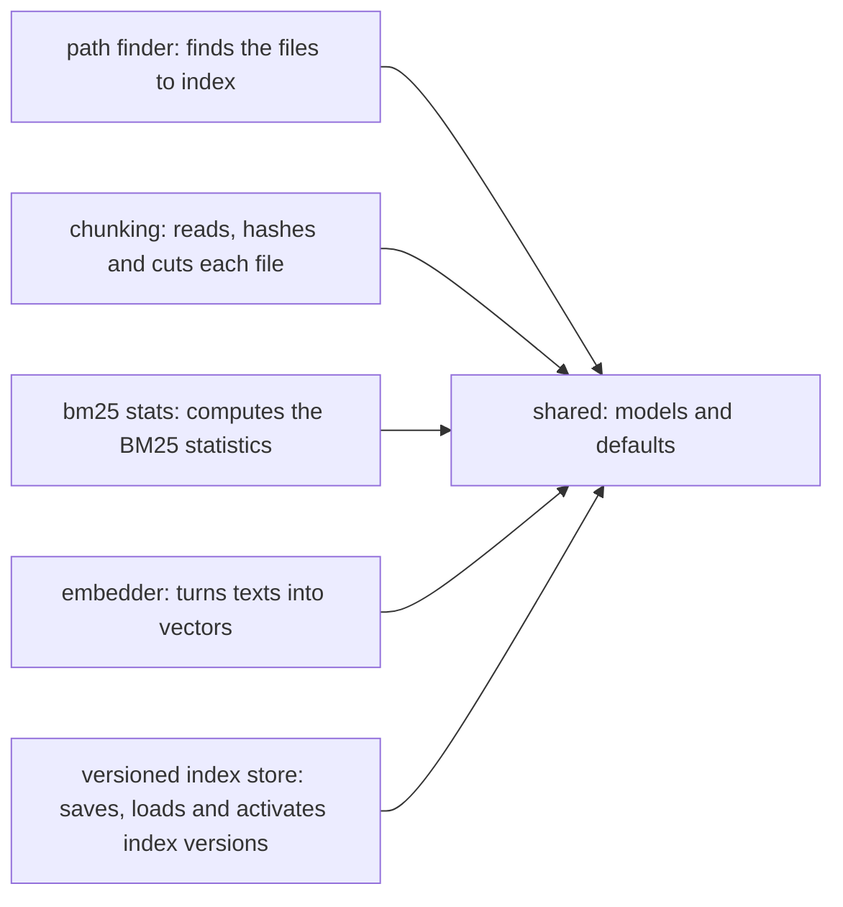

# Block division

- date: 2026-11-09
- coherence: 2026-11-14

## Blocks

### Block 1: shared (src/shared/: models.py, defaults.py)
- receives: nothing (no other block, no external source)
- processes: nothing at runtime; defines the shared data structures and values
- delivers: the pydantic models of spec point 4.9 (data models), the internal models (Chunk with its text and character range, the settings of each index version), the default values and the fixed limits (e.g. max_chunk_size ceiling 2000)
- depends on: no block

### Block 2: path finder
- receives: the raw folder path, from the index command (CLI argument; default data/raw from block 1 shared)
- processes: walks the raw folder and keeps the .py, .md and .txt files (whitelist); does not read them
- delivers: the list of paths of the files to index; raises an exception when the folder is missing or has no such file (spec point 4.1 case 2)
- depends on: block 1 shared

### Block 3: chunking
- receives: from the "index" service, the list of paths found by path finder (list[str]) and the previous index version as {path: (hash, chunks)} (empty dict = full rebuild)
- processes: reads each file once in binary, skips empty and non-UTF-8 ones, compares its sha256 with the previous one, copies the old chunks if equal or cuts it with the chunker of its type (registry by extension, common base class)
- delivers: two dicts {path: (hash, chunks)}: the full one (valid files that exist now) and the one with only new or changed files
- depends on: block 1 shared

### Block 4: bm25 stats
- receives: from the "index" service, the full dict {path: (hash, chunks)} delivered by chunking
- processes: computes, over all chunks, the term frequency of each word in each chunk (tf), the number of chunks that contain each word (df), the length of each chunk in tokens, the average chunk length (avgdl) and the number of chunks (N)
- delivers: the statistics (tf, df, lengths, avgdl, N) to the "index" service, which passes them to the versioned index store to save them in the new version; it does not score: scoring with a query and the top-k are done at search time by another block (Bm25Retriever, spec point 7 method 1)
- depends on: block 1 shared

### Block 5: embedder
- receives: at index time, from the "index" service, only the dict of new or changed files of chunking; at search time, a query
- processes: turns texts into vectors with the embedding model: the chunks of new or changed files at index time, the query at search time (same model)
- delivers: at index time, the vectors of the new or changed chunks, to the "index" service (which merges them with the old ones); at search time, the query vector, to the SemanticRetriever (spec point 7 method 1)
- depends on: block 1 shared; external source: the embedding model all-MiniLM-L6-v2 (through its library)

### Block 6: versioned index store (name not decided yet)
- receives: to save a new version, from the "index" service: the chunks of every file with its path and hash, the BM25 statistics, the vectors of the chunks (optional: missing when the embedding model was not available, spec point 4.1 case 15) and the settings of the version (max_chunk_size and embedding model name)
- processes: at start, removes leftovers of dead runs (spec point 4.1 case 9); loads the active version (for the "index" service and for search: CLI and API); if a version with the same corpus and settings exists, only makes it active (nothing if it already is); otherwise writes the new version apart, verifies it inside the store and only then makes it active (if verification fails, removes it and the previous one stays active, case 7); when the corpus changes, removes the versions of the old generation (unless pending 90, two generations, is adopted)
- delivers: not decided yet
- depends on: block 1 shared (the models of chunks, settings and BM25 statistics, pending 86: block 4 statistics structure)

## Diagram (Mermaid)

## Decided

- Block 1 holds only shared data: the spec point 4.9 models, the internal models (Chunk, index version settings) and the defaults and fixed limits.
- Defaults in block 1 never replace CLI arguments: every path still comes from a CLI argument (prohibitions 3: no hard-coded input/output paths). Values computed at runtime (N, number of chunks of the active index; T, time of one answer on CPU) are not in block 1.
- Block 1 is named shared: package src/shared/ with models.py (pydantic models) and defaults.py (defaults and fixed limits).
- The interfaces of spec point 7 (retriever, chunker, generator) are not in block 1: each one goes in the block that implements it.

- Block 2 is named path finder (user decision, 2026-11-11; "route" rejected because in FastAPI routes are the API endpoints). The block name does not fix the class names: a block can hold several classes. It only finds files: it walks the raw folder and delivers the paths of the .py, .md and .txt files (whitelist, spec point 4.1 case 3); it does not read them (user decision, 2026-11-11). It receives the raw folder path from the index command as a CLI argument; its default data/raw comes from block 1 shared (prohibitions 3: no hard-coded paths) (user decision, 2026-11-11). If the raw folder is missing or has no .py, .md or .txt file (spec point 4.1 case 2), block 2 only raises an exception with the message; the index command (CLI layer) catches it, prints it on stderr, records it in the run log and returns exit code != 0 (spec point 7 method 4: thin CLI) (user decision, 2026-11-11). Block 2 depends only on block 1 shared (default raw folder and the extension whitelist); it does not depend on the CLI: the CLI calls block 2 and passes the path as a parameter, so there is no cycle and block 2 can be tested alone (user decision, 2026-11-11).
- Block 3 is named chunking (user decision, 2026-11-11: reading, hashing and comparing are parts of chunking). one chunker per type (.py, .md, .txt) chosen from a registry by extension (spec point 7 method 2, constraints 10). A common base class does the shared steps once, for every type (template method): read the file once in binary mode, skip it if empty, decode UTF-8 (warning and skip if it fails), compute the sha256 of the same bytes, and copy its previous chunks if the hash did not change (incremental, spec point 4.1 case 12); only then it calls the type's own chunk(text). Each chunker implements only chunk(text). Reading in binary and decoding keeps \r\n, so positions and hash come from the same bytes (user decision, 2026-11-11). It receives the paths found by path finder as a list[str], passed by an "index" function of the shared service layer (spec point 7 method 4) that chains path finder, chunking and the saving of the index version; the CLI only calls that service, path finder does not call chunking, and the API and the CLI never duplicate this sequence (user decision, 2026-11-11, option o3 over path finder calling chunking or the CLI passing the paths). From the previous index version it receives a dict {path: (hash, chunks)}, prepared by the "index" service through the versioned index store (spec point 7 method 3; the service never reads data/processed directly, and the file format is decided in the index block, pending 65). An empty dict means full rebuild: the service passes it when there is no previous version or it is unreadable (spec point 4.1 case 14, with a warning) or when max_chunk_size or the embedding model changed (case 13). The chunking block computes the hash itself and compares; it knows nothing of folders or formats (user decision, 2026-11-11). It delivers two dicts with the same shape {path: (hash, chunks)}, each chunk being the Chunk model of block 1 shared: the full one (only files that exist now and are valid; deleted, empty and non-UTF-8 files are left out) and the one with only new or changed files. The embeddings block gets only the second and returns its vectors; the "index" service merges them with the old vectors of the unchanged files (user decision, 2026-11-14); BM25 gets only the full one, because its statistics depend on all chunks and are always recomputed (spec point 4.1 case 12). The full dict is the next run's previous version, and the count of the second goes to the run log (goals 6) (user decision, 2026-11-11). The chunking block depends only on block 1 shared (the Chunk model and the 2000 ceiling); it does not depend on the "index" service, which calls it: depending means importing another block's code, not being called by it (user decision, 2026-11-11).

- The cache (spec point 4.8, caching) is not a piece of the "index" service: it stores query results of search and answer, and index makes no queries. Index never deletes cache entries, because it would have to import the cache block code (index -> cache, a cycle with cache -> index); the cache cleans its own entries of old index versions (when and how: pending 84, cache cleanup timing and check on write) (user decision, 2026-11-11).

- Block 4 (BM25 statistics, i3 of the "index" service pieces) processes, always over all chunks of the full dict from chunking (spec point 4.1 case 12: lexical statistics always recomputed): tf of each word in each chunk, df of each word, length of each chunk in tokens (not characters), avgdl and N. In BM25 each document is one chunk, not one file, so N is the number of chunks and df counts chunks (user decision, 2026-11-14). It delivers only the statistics, to the "index" service (i6), which passes them to the versioned index store (i5) to save them in the new version. It never scores: at index time there is no query (the index command takes no query, spec point 4.1), and one index version serves many queries; scoring with the query and the top-k belong to the search-time block (Bm25Retriever, spec point 7 method 1) (user decision, 2026-11-14). A query word that is not in the index adds 0 to every chunk. The structure kept and when idf is computed: pending 86 (block 4 statistics structure). Block 4 is named bm25 stats (user decision, 2026-11-14; "indexer" rejected because it clashes with the "index" service i6, and "lexical index" not chosen). It depends only on block 1 shared (the Chunk model): it imports no code of chunking or path finder; the "index" service calls chunking first and passes the full dict to bm25 stats in memory as a parameter, so the order is the service's job and bm25 stats reads no file (user decision, 2026-11-14).

- Block 5 (embeddings, i4 of the "index" service pieces) has one task: turn texts into vectors. At index time it gets only the dict of new or changed files of chunking and returns only their vectors (on a first run or a full rebuild, spec point 4.1 cases 13 and 14, that dict holds every file; when nothing changed it is empty and nothing is embedded). It does not get the old vectors: chunking already decided with the hash which files changed, so there is nothing to compare. The merge is done by the "index" service (i6): the versioned index store (i5) loads the previous version with its vectors, and for each file of the full dict i6 takes the new vectors if it changed or the old ones if not; deleted files are not in the full dict, so their vectors never reach the new version; i6 passes the result to i5 to save it (user proposal, approved 2026-11-14, over i4 receiving both dicts and the old vectors). It also embeds queries at search time, with the same embedding model as the chunks, for the SemanticRetriever (spec point 7 method 1): cosine similarity only compares vectors of the same model, and doing it in two places could silently use different models or settings. That it is a function of a class is decided in the development of the block (user decision, 2026-11-14). Without the embedding model, the index is built without the semantic part (spec point 4.1 case 15). Running embeddings and answer generation in parallel threads: pending 87 (embeddings and answer threads). Block 5 is named embedder: its only task is turning texts into vectors, for chunks and for queries (user decision, 2026-11-14). It depends only on block 1 shared (the Chunk model); the embedding model is an external source, used through its library (fastembed or sentence-transformers, pending 17: library comparison), not a block; when its weights are downloaded: pending 88 (embedding model download) (user decision, 2026-11-14).

- Block 6 (versioned index store, i5 of the "index" service pieces) receives from the "index" service, to save a new version: the chunks of every file with its path and hash, the BM25 statistics, the vectors (optional: a version without the semantic part is valid, spec point 4.1 case 15, so --method hybrid falls back to bm25 with a warning) and the settings of the version, max_chunk_size and embedding model name (spec point 4.1 case 11). The settings are needed so the next index run knows when to rebuild everything (case 13) and so queries are embedded with the same model as the chunks. It depends only on block 1 shared; for this, the model of the BM25 statistics goes in shared (pending 86) (user decision, 2026-11-14). Versions per settings (user proposal, approved 2026-11-14): a version is identified by the corpus generation plus its settings (e.g. v1_1000, v1_2000); index with existing settings only switches the active version, with nothing changed it builds nothing ("index already up to date"), with new settings it builds v1_<new> and keeps the others, and when the corpus changes it builds the new generation incrementally and deletes the old one; one single active version, the last indexed (search and the API take no max_chunk_size). Spec point 4.1 is edited when block 6 is closed: pending 89 (spec change for versions per settings). Keeping two generations is a test candidate: pending 90 (disk of two generations). Reusing a version built with one max_chunk_size for another one (e.g. v1_1000 for 800 or for 1500) is rejected (user decision, 2026-11-14): measured on the corpus, 1723 of 1969 files are longer than 800 characters, and 4644 of 10993 top-level .py units are longer than 1000, 1368 of them between 1000 and 1500, so the chunks differ and reusing them would fake the chunk size measurement of pending 29; a version is reused only when its settings match exactly. What block 6 processes (user decision, 2026-11-14): removes leftovers at start; loads the active version (loading means reading it from disk into memory for whoever asks: the "index" service, to compare hashes and copy what did not change, and search, to score; each command is a separate process, so search starts with nothing in memory); switches to an existing version with the same corpus and settings, or writes, verifies and activates a new one; removes the old generation when the corpus changes. Verification is part of the store, inside the index command, never a separate script, because the evaluator only runs the commands; the pointer file and subfolders are in pending 65 (index store implementation).

## Pending

- Next session (user decision, 2026-11-11): first define every piece the "index" service uses, then the service itself. Done: i1 path finder, i2 chunking, i3 bm25 stats (block 4, 2026-11-14), i4 embedder (block 5, 2026-11-14); i5 versioned index store (block 6) in progress. To define, one by one: i3 BM25 statistics (gets the full dict from chunking, always recomputed over all chunks); i4 embeddings (gets only the new or changed files and returns their vectors; the "index" service merges them with the old ones; without the model the index is built without the semantic part, spec point 4.1 case 15); i5 versioned index store (loads the previous version for chunking; writes, verifies and activates the new one, spec point 4.1 cases 7 to 11, pending 65); i6 the "index" service itself (chains i5 load → i1 → i2 → i3 → i4 → i5 save). The user confirmed this list is complete; the cache is not one of them (2026-11-11). Next session starts with i3 BM25 statistics (user decision, 2026-11-11); then i4 and i5, and i6 last.
- Block 3 chunking: how max_chunk_size (index command argument, spec point 4.1) reaches the chunkers, which cut to it; not decided yet (found by the external review of the close, 2026-11-11).
- Service layer (the "index" orchestrator and the other service functions: search, search_dataset, answer, answer_dataset, evaluate with recall@k): which block holds it.
- Block 6 (versioned index store, i5), next point to decide (open at the close of 2026-11-14): what it delivers. Proposed by the agent: e1, on save or activate, the name of the active version (for the message of spec point 4.1 case 10) or an error (case 7); e2, on load, the content of the active version (chunks with path and hash, BM25 statistics, vectors, settings) or "no index" (spec point 4.2 case 1, 4.1 case 14), and only block 6 reads the pointer file and the subfolders. User objection, not yet resolved: everything can be found from the pointer file, so block 6 need not deliver more; agent answer: the pointer only names the active version, and if i6, the CLI and the API read the disk themselves, all three must know the disk format (pending 65) and repeat its error cases (spec point 7 method 3). After it: name of block 6 and the "index" service (i6).
- Spec point 4.1 cases 10 and 13 and a new case must be edited when block 6 (versioned index store) is closed: pending 89 (spec change for versions per settings).
- Blocks after these: not proposed yet (the user proposes them block by block, row 403 of workflow).
